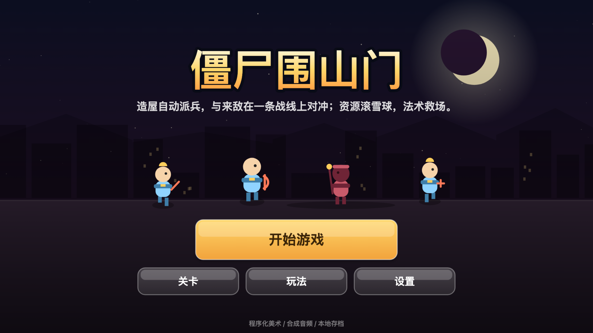
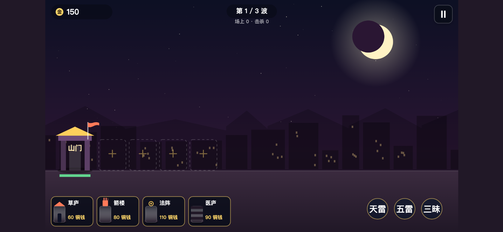
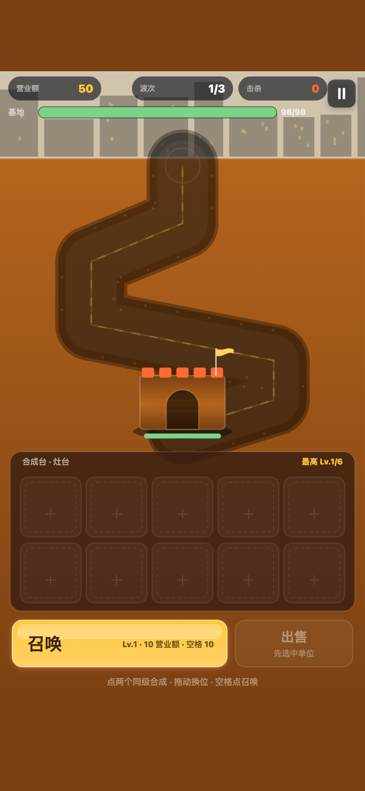

# 游戏工坊 · DSH Game Studio

> 一句话生成一款**完整可玩**的游戏：HTML5（单文件离线、双击即玩）或 **Cocos Creator 3.8 工程**（可构建 Web/Android/iOS/鸿蒙）。
> 两种目标共用同一套玩法逻辑与内容数据，并自带自动验收：机器人逐关仿真 / Cocos CLI 构建 / 无头 Chrome 截图与冒烟。

这是 [DeepSeek Harness](https://github.com/deepseek-ai) 的插件（bundle）：注册 5 个模型工具与一个随包 skill。

- **HTML5 目标**：不依赖任何引擎、外部素材或网络；Canvas 程序化美术 + WebAudio 合成音乐音效 + localStorage 存档，单文件 120~170KB，双击即玩。
- **Cocos 目标**：标准 Cocos Creator 3.8.8 工程（场景 / TS 脚本 / 项目配置），`CanvasSurface` 把同一套 Canvas2D 绘制代码桥接到 Cocos Graphics + Label，
  因此**玩法/内容完全同源**，可直接用 Cocos 生态做多端发行。





## 内置演示（全部由本插件一句话生成）

| # | 游戏 | 一句话需求 | 玩法基因 | 题材 | 方向 | 单文件 |
|---|---|---|---|---|---|---|
| 1 | [僵尸围山门](examples/01-zombie-defense/) | 僵尸围山门的塔防，30 关横屏 | 自走塔防 | 中式僵尸 | 横屏 | 166.3 KB |
| 2 | [星海幸存者](examples/02-star-survivor/) | 太空割草生存，24 关横屏 | 割草生存 | 太空科幻 | 横屏 | 130.1 KB |
| 3 | [火锅店合成记](examples/03-hotpot-merge/) | 厨房合成塔防，24 关竖屏 | 合成塔防 | 厨房餐厅 | 竖屏 | 151.2 KB |
| 4 | [老小区归位](examples/04-parking-sort/) | 小区停车排序解谜，25 关竖屏 | 排序解谜 | 都市夜景 | 竖屏 | 138.9 KB |
| 5 | [深海打捞](examples/05-deepsea-hook/) | 海底钩爪打捞，24 关竖屏 | 钩爪打捞 | 海底打捞 | 竖屏 | 129.4 KB |
| 6 | [三十天开播](examples/06-streamer-idle/) | 主播放置经营，24 关竖屏 | 放置经营 | 都市夜景 | 竖屏 | 129.8 KB |

每款都带 HTML 单文件、`check-report.json` / `cocos-check.json`、`shots/` 截图与可编辑工程；
Cocos 版工程在 [examples/cocos/](examples/cocos/)（打开方式见各目录 README）。详见 [examples/README.md](examples/README.md)。

## 快速开始

### 作为 DSH 插件安装

插件管理里添加本地目录，或：

```
plugin_manager { action: "install_bundle", target: "<此目录绝对路径>" }
```

安装后对话里直接说一句：

> 做一个僵尸围山门的塔防，30 关，手机横屏

助手会调用 `game_forge`，返回单文件路径（双击即玩）与工程目录。

### 工具

| 工具 | 作用 |
|---|---|
| `game_genres` | 列出玩法基因与题材/关键词 |
| `game_plan` | 解析一句话 → 题材、玩法基因、标题、关卡数、横竖屏（不落盘） |
| `game_forge` | **核心**：一句话 → 完整工程 + 构建产物 + 自检；`engine: "html" \| "cocos"` |
| `game_build` | 重新构建单文件 |
| `game_check` | 数据 / 无头仿真 / 单文件 / 浏览器冒烟自检 |

### 不进 DSH 也能用（CLI）

```bash
node engine/forge.mjs genres
node engine/forge.mjs plan  --brief "海底钩爪打捞，24关竖屏"
node engine/forge.mjs forge --brief "做一个塔防，30关横屏" --dir /tmp/my-game
node engine/forge.mjs forge --brief "做一个塔防，30关横屏" --dir /tmp/my-cocos --engine cocos
node engine/forge.mjs check --dir /tmp/my-game
```

## 它是怎么工作的

```
一句话 ──► brief 解析：题材（10 套关键词计分）× 玩法基因（6 种标签计分）× 标题/关卡数/横竖屏/引擎（html|cocos）
        ──► 基因内容生成：难度曲线、关卡、单位/敌人/法术表、章节、帮助文案（全部用主题词库起名）
        ──► 固定壳层：标题 / 选关 / 战斗 / 暂停 / 结算 / 设置 / 说明 / 存档 / 音频（所有游戏共用）
        ──► 单文件构建：ESM→IIFE、CSS 内联、零外链断言
        ──► 六道交付闸：数据校验 / 机器人逐关仿真 / 单文件 / 无头 Chrome 截图与 FPS / 截图验收 / 可玩性
```

题材与玩法正交：10 题材 × 6 基因 = 60 种组合。换皮只改 `theme`，换玩法只换 `rules` + `buildContent`。

## 质量标准（生成即验收）

- **数据**：关卡 id 从 1 连续、章节全覆盖、无 NaN/Infinity；
- **无头仿真**：机器人以固定 1/60 步长逐关试玩，要求**全部通关**；"完全不操作"应基本不通关（证明有挑战）；
- **单文件（HTML）**：零 `src/href` 外部引用、体积预算内；
- **构建（Cocos）**：Cocos Creator CLI 3.8.8 构建 Web Mobile 成功，产物 `build/web-mobile/index.html`；
- **浏览器冒烟**：无头 Chrome 无运行时错误、自动截图到 `shots/`；Cocos 档用 WebGL 软件渲染跑启动/战斗/结算。

本仓库 6 款演示实测：仿真 24/24~30/30 全通关、摆烂 0 通关、单文件 129~165KB、浏览器 60fps。

## 仓库结构

```
index.js                Host 插件：5 个工具 + 随包 skill 注册（零依赖）
cordis.patch.yml        bundle 装配
engine/                 生成引擎（独立子进程运行，改引擎无需重启 DSH）
  forge.mjs             CLI：genres / plan / forge / build / check
  lib/                  brief 解析、题材库、基因注册、内容生成、工程写出、自检
  base/                 所有游戏共用的壳层（app/core/platform/render/art + HTML/CSS）
  cocos/                Cocos 运行时模板：GameRoot 宿主、CanvasSurface 桥、场景/项目配置、构建与冒烟脚本
  rules/                6 个玩法基因的规则实现
  tools/                预览/构建/无头仿真/浏览器冒烟/自检 模板
skills/game-studio/     随包 skill：游戏开发方法论与流水线作业手册
docs/PLAYBOOK.md        从 14 个已交付游戏项目提炼的方法论
examples/               6 款一句话生成的完整游戏（含单文件与截图）
locale/ icon.svg        插件展示元数据
```

## 文档

- [交付说明（v1.1.0 双运行时）](docs/DELIVERY.md)
- [游戏开发方法论（从 14 个项目提炼）](docs/PLAYBOOK.md)
- [作业手册（随包 skill）](skills/game-studio/SKILL.md)
- [演示游戏索引](examples/README.md)
- [更新日志](CHANGELOG.md)

## 已知边界

- 美术是**程序化占位风格**（几何 + 调色板），不是正式美术资源；替换接口在工程的 `js/art.js`（有图用图、无图程序化），需自行提供授权素材。
- 音频为 WebAudio 合成音色，不是成品配乐 / 配音。
- 不生成联网 / 联机玩法；Cocos 档只产出工程与 Web Mobile 构建，Android / iOS / 鸿蒙安装包需在 Cocos Creator 里用对应平台构建（需安装对应 SDK）。
- Cocos 档的渲染桥是 Canvas2D 子集（Graphics + Label）：径向光晕、阴影、线虚线为近似或省略；正式美术/动效可在 CanvasSurface 或 Cocos 里替换。
- 浏览器自检依赖本机 Chrome / Chromium；没有时只跑数据 / 仿真 / 单文件三项。
- 生成器覆盖内置基因的玩法骨架；复杂商业玩法（SLG、开放世界等）需在这个骨架上继续开发。

## License

未声明开源许可证。如需开源请补充 `LICENSE`（默认保留所有权利）。
